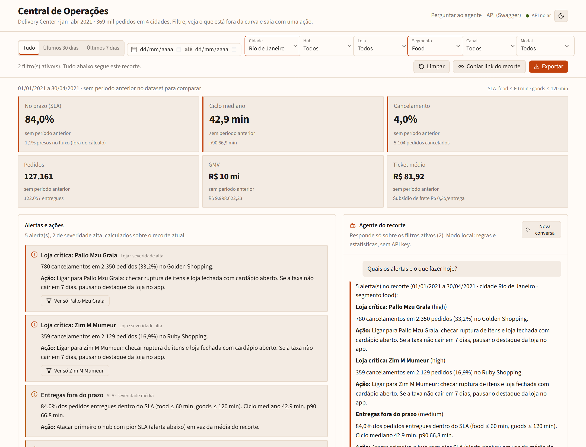
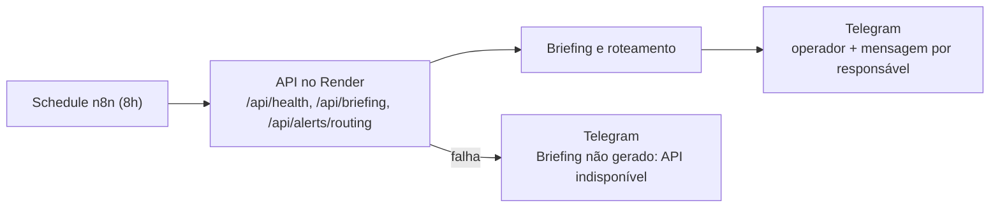
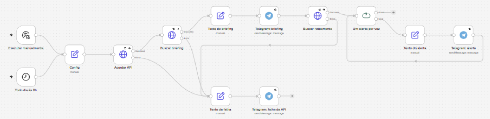
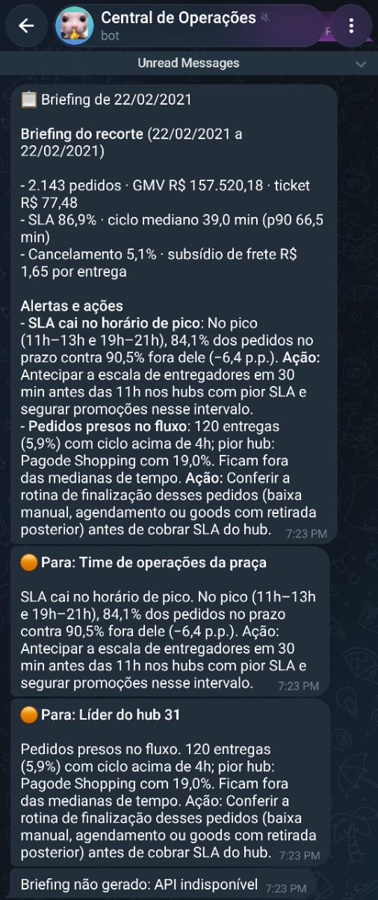
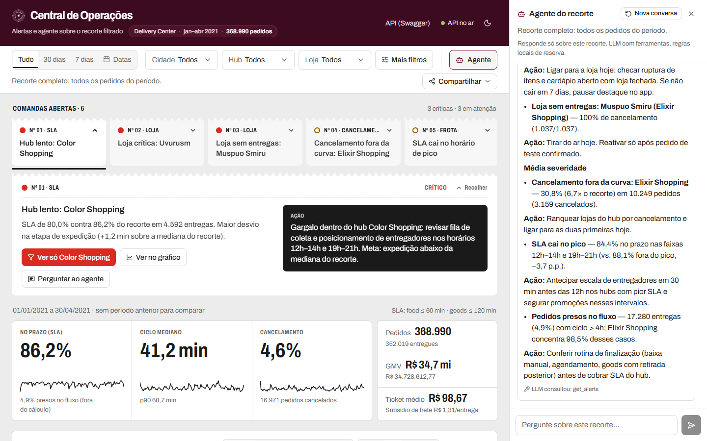
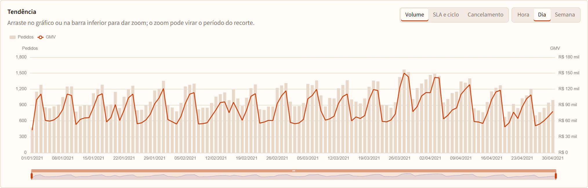
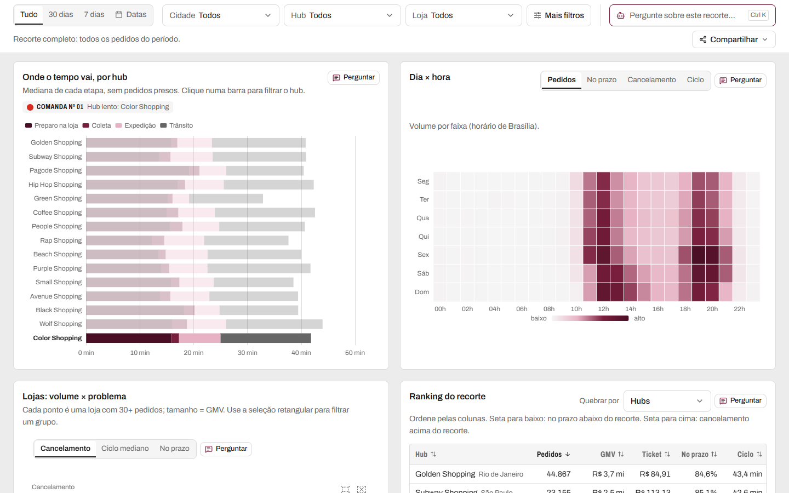
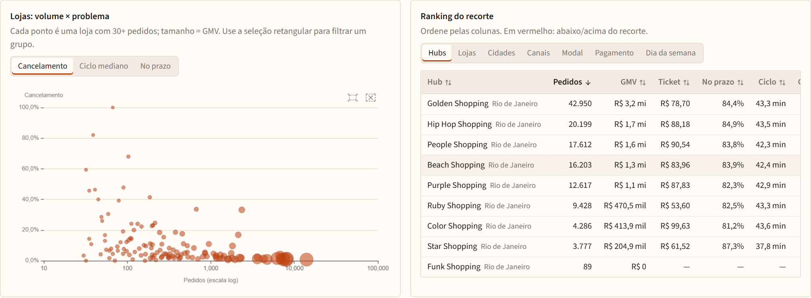
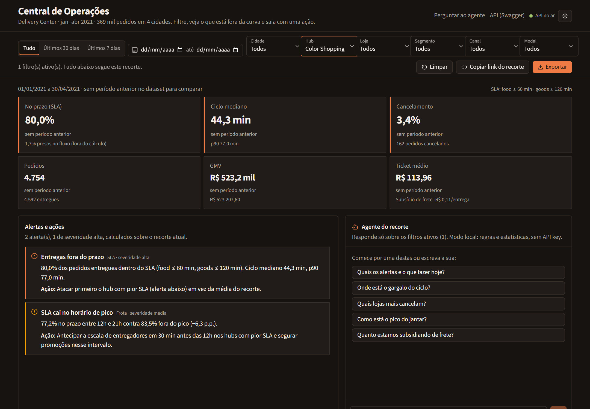

# Central de Operações: painel de delivery com alertas e agente

Painel interno para quem opera hubs de delivery: filtre um recorte (período, cidade, hub, loja, segmento, canal, modal, status) e veja **o que está fora da curva e o que fazer hoje**: qual hub estourou o SLA e em qual etapa, qual loja ligar, quando reforçar a frota.

Roda sobre **368.990 pedidos reais** do dataset [Delivery Center](https://www.kaggle.com/datasets/nosbielcs/brazilian-delivery-center) (jan–abr/2021, 32 hubs em São Paulo, Rio, Curitiba e Porto Alegre).

**App:** [dashboard-insight-kappa.vercel.app](https://dashboard-insight-kappa.vercel.app/) · **API:** [central-operacoes-api.onrender.com/docs](https://central-operacoes-api.onrender.com/docs)

> A API roda no plano grátis do Render e dorme sem acesso. Na primeira visita o topo mostra "Acordando o servidor (até ~40 s)".



## Automação diária

Todo dia às 8h, horário de São Paulo, o n8n pede à API o briefing de um dia do dataset e o roteamento dos alertas, e envia as mensagens no Telegram. Se a API não responder, o chat recebe o aviso de que o briefing não foi gerado.





<!-- GIF da demonstração (assets/n8n-demo.gif) entra aqui quando for gravado. -->



O n8n roda local, na Community Edition gratuita. O workflow está em `n8n/` e pode ser importado em qualquer instância.

Importar e ligar o bot: [n8n/README.md](n8n/README.md). O que cada nó faz: [n8n/COMO-FUNCIONA.md](n8n/COMO-FUNCIONA.md). Mensagens de uma execução real: [n8n/exemplo-briefing.md](n8n/exemplo-briefing.md).

## O problema

Um dashboard com gráficos não diz para o operador o que fazer. Ele precisa de respostas no recorte que está olhando:

- O SLA estourou? Em qual hub? É a loja demorando para preparar ou é trânsito?
- O cancelamento é geral ou de duas lojas com cadastro quebrado?
- O pico do jantar está pior que o resto do dia?

Por isso tudo aqui (KPIs, gráficos, tabelas, exportação, alertas e agente) usa **o mesmo recorte**, e cada alerta termina com uma **ação** específica e um botão que filtra o painel no hub ou loja em questão.

## O que dá para fazer

| | |
|---|---|
| **Fila de comandas** | Os alertas aparecem como comandas num trilho, da mais grave para a menos grave. A severidade aparece também na forma (círculo cheio = crítico, vazado = atenção, traço = observar). A comanda aberta mostra o problema com números, a **ação** (quem faz o quê, onde e quando) e três saídas: filtrar o painel no hub/loja, **ver no gráfico** (rola até o gráfico e destaca as barras, horas ou lojas do alerta) e perguntar ao agente. |
| **Alertas cobertos** | Hub lento com a etapa que explica o atraso; cancelamento alto no recorte, no hub ou na loja; loja sem entregas (tirar do ar); SLA no horário de pico; pedidos presos no fluxo; queda de volume com o canal que mais caiu; subsídio de frete com a loja que mais pesa. Com menos de 100 entregas medidas, o alerta vira "observar" e sugere ampliar o período. |
| **Agente do recorte** | Abre num painel lateral (telas largas), flutuante (médias) ou numa folha (celular), com `Ctrl+K` ou pelo botão "Perguntar" de cada painel, que já preenche a pergunta. Sem API key, responde com regras e estatísticas locais. Com `OPENROUTER_API_KEY`, usa LLM com **tool calling** (`get_kpis`, `get_breakdown`, `get_alerts`, `get_timeseries`). O recorte é aplicado pelo servidor, então o modelo escolhe o que consultar mas nunca sobre quais dados. Cada resposta diz se veio de regras locais ou quais ferramentas o LLM consultou. |
| **KPIs** | No prazo (SLA), ciclo mediano (com p90) e cancelamento, com minigráfico diário; pedidos, GMV e ticket médio. Compara com o período anterior de mesmo tamanho e avisa quando a base é pequena demais para comparar. |
| **Gráficos (ECharts)** | Tendência com zoom que vira período do filtro; etapas do ciclo por hub (clique filtra); mapa de calor dia × hora; dispersão de lojas com seleção retangular para filtrar um grupo. |
| **Tabelas (TanStack)** | Ranking por hub/loja/cidade/canal/modal/pagamento/dia da semana, com setas onde o SLA ou o cancelamento fogem do recorte. Pedidos brutos com ordenação e filtros de coluna no servidor e rolagem virtualizada. |
| **Compartilhar e exportar** | O recorte fica na URL (`?city=Curitiba&hub=8`). O menu "Compartilhar" copia o link, baixa os pedidos em CSV, copia um briefing em Markdown (KPIs + alertas com ação) e gera PDF da tela. |
| **Tema e celular** | Tema claro e escuro. No celular os filtros viram uma folha e o agente abre por um botão flutuante. |







## Arquitetura

```
frontend/ (Vercel)                         backend/ (Render)
Astro: casca estática, zero JS     HTTP    FastAPI + Pydantic
 └─ ilhas React (client:load/visible) ───▶  ├─ repository.py  DuckDB em memória ← data/orders.parquet
    Nanostores: recorte ↔ URL               ├─ alerts.py      regras → alerta + ação + evidência + drill-down
    TanStack Query: cache, cancelamento     └─ agent/         LLM com tools → contexto → regras locais
    ECharts · TanStack Table/Virtual
    Tipos TS gerados do OpenAPI
```

Decisões que vale conhecer:

- **DuckDB sobre Parquet, sem banco.** O dataset tem 9,8 MB em Parquet; o DuckDB carrega tudo em memória e agrega 369 mil linhas em ~50 ms. O SQL recebe valores só por parâmetros, e colunas e ordenações vêm de listas fixas.
- **Um contrato de filtro.** `Filters` (Pydantic) é a query string da API e da URL do navegador. Os tipos TypeScript são gerados do OpenAPI: se um schema muda, o `astro check` quebra no build.
- **Ilhas que se falam sem Provider global.** O filtro grava num átomo Nanostores; KPIs, gráficos, tabelas e agente são ilhas separadas que escutam o mesmo átomo e compartilham um `QueryClient`. A comanda aberta publica sua evidência num segundo átomo, que os gráficos usam para destacar o que o alerta aponta.
- **Sem salto de layout.** Moldura, título e dica fixa de cada painel saem no HTML do Astro; a ilha só preenche o corpo, e o skeleton reserva a altura final. Acima da dobra hidrata com `client:load`; gráficos e tabelas com `client:visible`; a conversa do agente entra com `React.lazy`.
- **Agente com limites.** Até 3 rodadas de ferramentas, orçamento de 20 s por pergunta, histórico curto, corpo de até 64 KB e 8 perguntas por minuto por IP. Se o LLM falha, demora ou a cota acaba, a resposta vem das regras locais em vez de um erro.

## Limpeza dos dados

O ETL (`backend/scripts/build_parquet.py`) junta os 7 CSVs num parquet desnormalizado. Estas decisões mudam números, e o rodapé do app também as mostra:

- **Fuso:** os horários do dataset estão em UTC (picos às 15h e 22h). Convertidos para Brasília, os picos ficam no almoço e no jantar.
- **SLA por segmento:** food ≤ 60 min, goods ≤ 120 min. Goods tem um ciclo bem mais longo e não dá para medir pela mesma régua.
- **Pedidos presos:** ciclo > 4h (4,9% das entregas, concentradas em goods) fica fora das medianas e do SLA e gera um alerta de dados próprio.
- **Outliers:** pedidos acima de R$ 5 mil (63, como um de R$ 100.000,11) ficam fora do GMV. Distâncias acima de 50 km e métricas negativas viram nulo.
- **Várias entregas/pagamentos por pedido:** vale a última entrega concluída e o meio de pagamento de maior valor.
- **Amostra pequena:** SLA e ciclo com menos de 100 entregas medidas não geram alerta forte nem comparação com o período anterior.

## Rodar localmente

```bash
# backend: Python 3.11+
cd backend
python -m venv .venv && .venv\Scripts\activate      # Linux/macOS: source .venv/bin/activate
pip install -r requirements-dev.txt
uvicorn app.main:app --reload                       # http://localhost:8000/docs
pytest                                              # 104 testes, com parquet sintético

# frontend: Node 20+
cd frontend
npm install
npm run dev                                         # http://localhost:4321
npm run build                                       # astro check + build estático
```

O parquet processado já vem no repositório. Para refazer o ETL, coloque os CSVs do Kaggle em `backend/data/raw/` e rode `python scripts/build_parquet.py`.

Mudou um schema Pydantic? Regere os tipos do frontend: `python scripts/export_openapi.py && (cd ../frontend && npm run gen:api)`.

Agente com LLM (opcional): copie `backend/.env.example` para `backend/.env` e preencha `OPENROUTER_API_KEY`. O backend também lê o `.env` da raiz. Variáveis opcionais:

| Variável | Padrão | Para quê |
|---|---|---|
| `OPENROUTER_MODEL` | `nvidia/nemotron-3-ultra-550b-a55b:free` | Modelo usado pelo agente |
| `LLM_TIMEOUT_S` | `45` | Tempo máximo de cada chamada ao LLM |
| `CHAT_BUDGET_S` | `20` | Tempo total por pergunta antes de cair nas regras locais |
| `CHAT_RATE_LIMIT_PER_MINUTE` | `8` | Perguntas ao LLM por minuto por IP |
| `CHAT_RATE_LIMIT_ENABLED` | `true` | Liga a cota acima |

## API

A query string é o recorte do painel: `start`, `end`, `city`, `hub`, `store`, `segment`, `channel_type`, `modal` e `status`. O contrato inteiro está em `/docs`.

Dois GETs em `/api` alimentam automação (agendador, mensagem) sem chamar o agente com LLM. Data inválida ou `end` anterior a `start` responde 422, como o resto da API. Resposta 200 de GET leva `Cache-Control: public, max-age=600`.

| | |
|---|---|
| `GET /api/briefing` | `{markdown, start, end, alert_count}`. `markdown` é o briefing local do recorte. `start` e `end` são as datas pedidas; sem elas, o primeiro e o último dia com pedido no recorte, ou `null` se não houver pedido. `alert_count` é o tamanho da fila de alertas. |
| `GET /api/alerts/routing` | Lista `{alert_id, severity, recipient, message}`. `recipient` sai do drill-down ou da evidência do alerta: `Loja {nome} ({id})` ou `Líder do hub {nome} ({id})`, com o nome vindo dos dados. Sem loja nem hub, fica `Time de operações da praça`. `message` junta o problema (números já em pt-BR) e a ação. Template fixo, sem LLM. |

## Deploy

1. **Backend (Render):** *New → Blueprint* apontando para este repo (usa `render.yaml`). Preencha `CORS_ORIGINS` com a URL da Vercel (ou `CORS_ORIGIN_REGEX` para aceitar os previews) e, se quiser, `OPENROUTER_API_KEY`. O plano grátis dorme depois de 15 min sem acesso; o app mostra "Acordando o servidor" enquanto isso.
2. **Frontend (Vercel):** importe o repo com *Root Directory* = `frontend` e defina `PUBLIC_API_URL` com a URL do Render.

## Stack

Astro 7 · React 19 · TypeScript · Tailwind CSS 4 · Lucide · Apache ECharts 6 · Nanostores · TanStack Query / Table / Virtual · Python · FastAPI · Pydantic · DuckDB · Parquet · OpenRouter (API compatível com OpenAI).

Dados: Delivery Center, Kaggle. Os nomes de lojas vêm anonimizados no próprio dataset. Projeto independente, sem relação com o iFood.
