# Central de Operações: painel de delivery com alertas e agente

Painel interno para quem opera hubs de delivery: filtre um recorte (período, cidade, hub, loja, segmento, canal, modal, status) e veja **o que está fora da curva e o que fazer hoje**: qual hub estourou o SLA e em qual etapa, qual loja ligar, quando reforçar a frota.

Roda sobre **368.990 pedidos reais** do dataset [Delivery Center](https://www.kaggle.com/datasets/nosbielcs/brazilian-delivery-center) (jan–abr/2021, 32 hubs em São Paulo, Rio, Curitiba e Porto Alegre).

**App:** [dashboard-insight-kappa.vercel.app](https://dashboard-insight-kappa.vercel.app/) · **API:** [central-operacoes-api.onrender.com/docs](https://central-operacoes-api.onrender.com/docs)

> A API roda no plano grátis do Render e dorme sem acesso. Na primeira visita o topo mostra "Acordando o servidor (até ~40 s)".

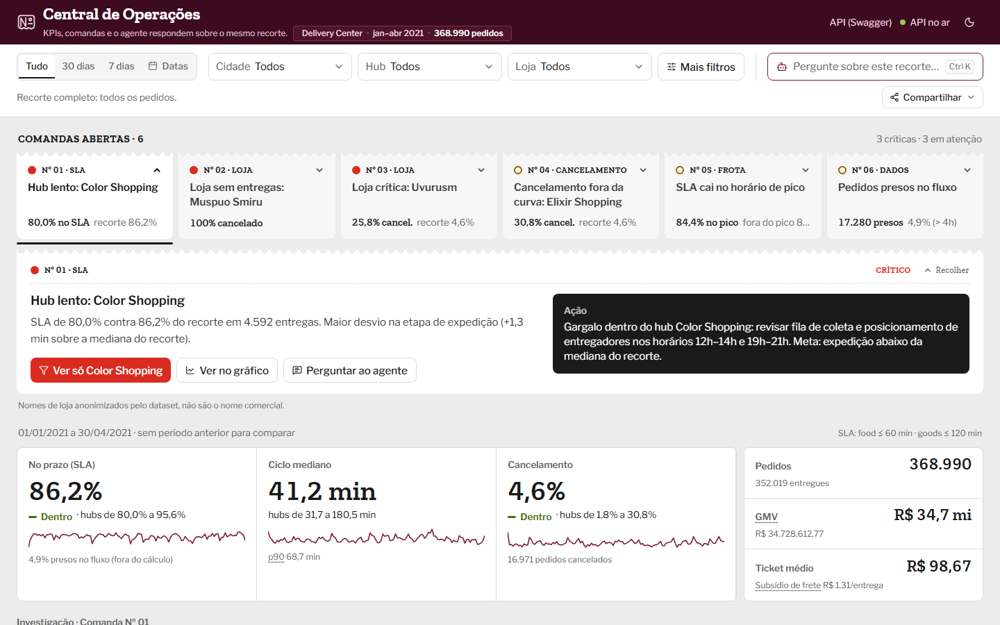

## Vídeo

Um minuto mostrando o painel: comanda aberta, investigação, KPIs, agente e o briefing no Telegram. Clique na capa para assistir.

<a href="video/out/linkedin.mp4">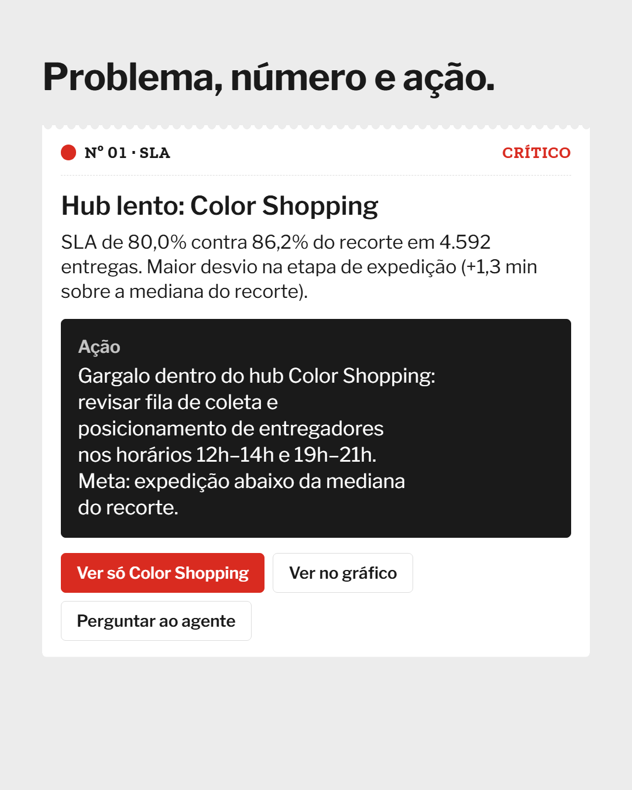</a>

O vídeo tem 58 s, sem áudio, em 1080 × 1350, e foi feito em código com [Remotion](https://www.remotion.dev/), recriando a interface do painel. Roteiro: [video/roteiro-linkedin.md](video/roteiro-linkedin.md). Como renderizar e editar: [video/remotion/README.md](video/remotion/README.md).

## Automação diária

Todo dia às 8h, horário de São Paulo, o n8n pede à API o briefing de um dia do dataset e o roteamento dos alertas, e envia as mensagens no Telegram. Se a API não responder, o chat recebe o aviso de que o briefing não foi gerado; se o briefing saiu e só o roteamento falhou, o aviso diz que os alertas não foram encaminhados.

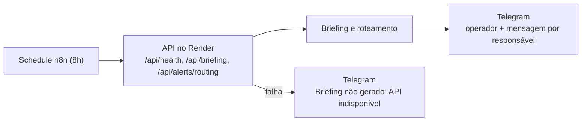

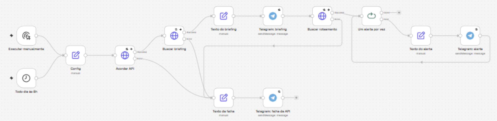

<!-- GIF da demonstração (assets/n8n-demo.gif) entra aqui quando for gravado. -->

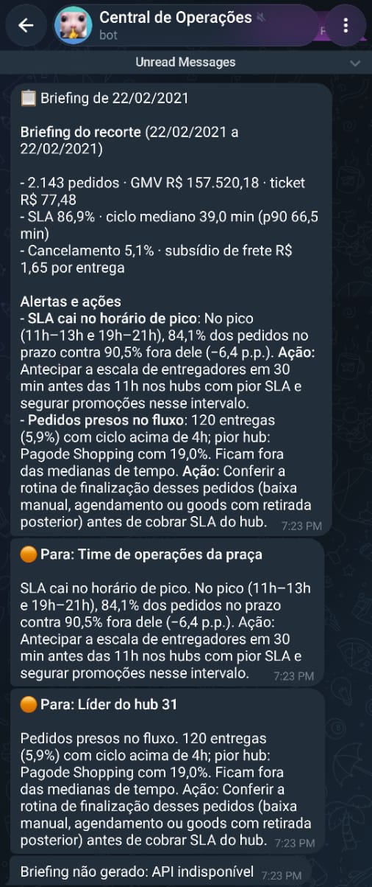

O n8n roda local, na Community Edition gratuita. O workflow está em `n8n/` e pode ser importado em qualquer instância. Ele chama a API sem header de autenticação. Se `AUTOMATION_TOKEN` estiver definido no backend, `/api/briefing` e `/api/alerts/routing` passam a exigir `X-Automation-Token`; deixe a variável vazia para o workflow versionado continuar funcionando.

Importar e ligar o bot: [n8n/README.md](n8n/README.md). O que cada nó faz: [n8n/COMO-FUNCIONA.md](n8n/COMO-FUNCIONA.md). Mensagens de uma execução real: [n8n/exemplo-briefing.md](n8n/exemplo-briefing.md).

## O problema

Um dashboard com gráficos não diz para o operador o que fazer. Ele precisa de respostas no recorte que está olhando:

- O SLA estourou? Em qual hub? É a loja demorando para preparar ou é trânsito?
- O cancelamento é geral ou de duas lojas com cadastro quebrado?
- O pico do jantar está pior que o resto do dia?

Por isso tudo aqui (KPIs, gráficos, tabelas, exportação, alertas e agente) usa **o mesmo recorte**, e cada alerta termina com uma **ação** específica e um botão que filtra o painel no hub ou loja em questão.

## O que dá para fazer

| | |
|---|---|
| **Fila de comandas** | Os alertas aparecem como comandas num trilho, da mais grave para a menos grave. A severidade aparece também na forma (círculo cheio = crítico, vazado = atenção, traço = observar). Cada comanda do trilho já mostra o número principal e a referência (ex.: "80,0% no SLA · recorte 86,2%"). A comanda aberta mostra o problema com números, a **ação** (quem faz o quê, onde e quando) e até três saídas: filtrar o painel no hub/loja (quando o alerta aponta um), **ver no gráfico** (rola até o gráfico da investigação e destaca as barras, horas ou lojas do alerta) e perguntar ao agente. |
| **Alertas cobertos** | SLA do recorte fora do prazo e hub lento com a etapa que explica o atraso; cancelamento alto no recorte, no hub ou na loja; loja sem entregas (tirar do ar); SLA no horário de pico; pedidos presos no fluxo; queda de volume com o canal que mais caiu; subsídio de frete com a loja que mais pesa. Hub só entra na comparação com 300 pedidos ou mais, loja com 150. Nos alertas de SLA com menos de 100 entregas medidas, e nos de cancelamento com menos de 100 pedidos (salvo taxa extrema), a comanda vira "observar" e orienta ampliar o período, ou avisa que a base não sustenta ação quando o recorte já cobre todos os dados. |
| **Agente do recorte** | Abre num painel lateral (telas largas), flutuante (médias) ou numa folha (celular), com `Ctrl+K` ou pelos botões "Perguntar" dos painéis, da comanda, do detalhe do pedido e do fechamento, que já preenchem a pergunta. Sem API key, responde com regras e estatísticas locais. Com `OPENROUTER_API_KEY`, usa LLM com **tool calling** (`get_kpis`, `get_alerts`, `get_timeseries`, `query_metrics`, `explain_change`, `drill_cause`) sobre uma camada semântica (`backend/app/semantic.toml`: métricas, sinônimos, conceitos e mapa causal). `query_metrics` cruza até 2 dimensões com subfiltros, janelas (almoço, jantar, fim de semana) e comparação com o período anterior ou o resto do recorte; `explain_change` decompõe a variação de uma taxa em efeito taxa e efeito mix por hub ou loja; `drill_cause` aponta a etapa do ciclo que explica o atraso. Toda a conta é do backend. O modelo padrão é gratuito, e o chat avisa que ele pode demorar, errar ou ficar fora do ar. O recorte é aplicado pelo servidor, então o modelo escolhe o que consultar mas nunca sobre quais dados. Com LLM ligado, a leitura pelas regras aparece na hora e é substituída pela do modelo quando ela chega; dá para mandar outra pergunta sem esperar, e ela cancela o complemento em curso. Cada resposta vem como comanda (título, diagnóstico, ação e atalhos de filtro conferidos contra os hubs e lojas do recorte), diz se veio das regras ou quais ferramentas o LLM consultou e pode ser fixada no trilho de comandas, onde continua ao mudar o recorte, marcada com "Recorte mudou". A conversa sobrevive a recarregar a página na mesma aba. |
| **KPIs** | No prazo (SLA), ciclo mediano (com p90) e cancelamento, com veredito, referência e minigráfico diário; pedidos, GMV e ticket médio. A referência é a rede no mesmo período (traço pontilhado "rede" no minigráfico, quando cabe na escala), ou a faixa entre os hubs quando o recorte já é a rede. Compara com o período anterior de mesmo tamanho e avisa quando a base é pequena demais para comparar. |
| **Gráficos (ECharts)** | Só um aparece aberto por vez, na investigação da comanda (abaixo); os outros ficam em "Explorar o recorte". Tendência (volume, SLA e ciclo ou cancelamento; por hora, dia ou semana) com zoom que vira período do filtro ("Usar como período"); etapas do ciclo por hub (clique filtra); mapa de calor dia × hora (pedidos, no prazo, cancelamento ou ciclo); dispersão de lojas com troca de métrica e "Selecionar área" para filtrar um grupo. A métrica e a granularidade escolhidas também ficam na URL. |
| **Investigação da comanda** | Abaixo dos KPIs, a seção "Investigação · Comanda Nº XX" mostra o gráfico que prova a comanda aberta (etapas por hub, dia × hora ou lojas; a Tendência na métrica do KPI quando a comanda é de KPI). Sem comanda aberta, ou com uma comanda do agente, vira "Pulso do recorte" e mostra a Tendência. O Ranking fica sempre aberto; os outros gráficos e a tabela de pedidos ficam recolhidos em "Explorar o recorte" e só carregam ao abrir (o que você abriu continua aberto ao trocar de comanda). A página fecha com o "Fechamento do recorte": comandas abertas, a ação em foco, "Próxima comanda", copiar briefing, perguntar ao agente e CSV (pede confirmação acima de 10 mil pedidos e fica bloqueado acima do limite do servidor). |
| **Tabelas (TanStack)** | Ranking por hub/loja/cidade/canal/modal/pagamento/dia da semana, com setas onde o SLA ou o cancelamento fogem do recorte, asterisco em base pequena e atalho para filtrar a linha. Pedidos brutos com paginação e ordenação no servidor e rolagem virtualizada; clicar num pedido abre o detalhe (preparo, trânsito, distância, valor, pagamento em português, horário de Brasília), que recebe o foco e fecha com `Esc`, com atalhos para filtrar o hub ou a loja e perguntar ao agente. |
| **Compartilhar e exportar** | O recorte fica na URL (`?city=Curitiba&hub=8`). O menu "Compartilhar" copia o link, baixa os pedidos em CSV, copia um briefing em Markdown (KPIs + alertas com ação) e gera PDF da tela (relatório focado: botões somem, o trilho imprime a ação de todas as comandas, o que está aberto sai inteiro e o que está recolhido sai como título e resumo). No celular, "Copiar link" e "Exportar" ficam no rodapé da folha de filtros. |
| **Drill-down e desfazer** | Filtrar a partir de uma comanda, gráfico, tabela ou pedido tira os filtros de cidade, hub ou loja que não combinam com o novo (para não zerar o recorte) e mostra "Desfazer filtro" ao lado dos chips; `Ctrl+Z` faz o mesmo fora de campos de texto. |
| **Recorte vazio e link inválido** | Quando cidade, hub, loja e período não se cruzam, o painel explica qual combinação zerou o recorte, oferece "Limpar recorte" e recolhe KPIs e a metade de baixo da página. Parâmetros de um link compartilhado que não existem na base são ignorados com aviso. |
| **Tema, celular e acessibilidade** | Tema claro e escuro. No celular os filtros viram uma folha, o agente abre por um botão flutuante e alvos de toque e linhas da tabela de pedidos têm 44 px. Links de pular para comandas e filtros, trilho navegável por setas, equivalentes de teclado nos gráficos, glossário inline (p90, GMV, subsídio) e respeito a `prefers-reduced-motion`. |

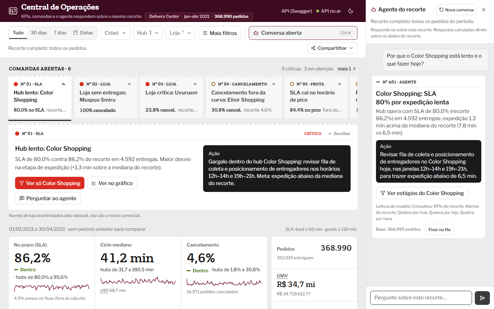
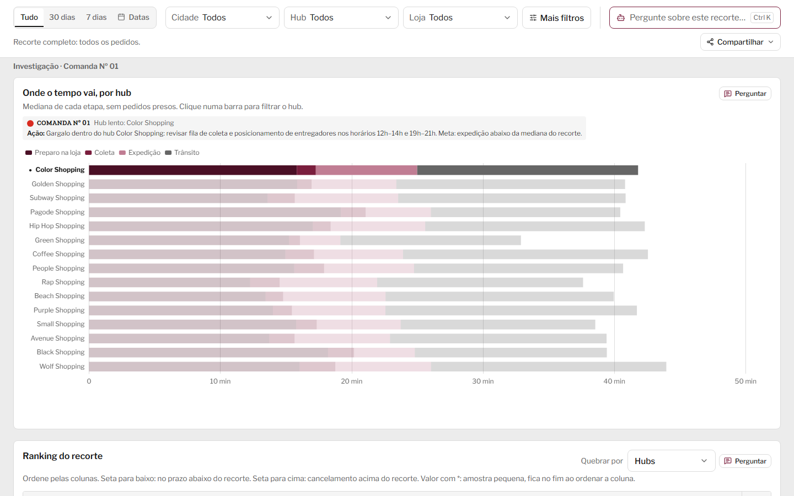
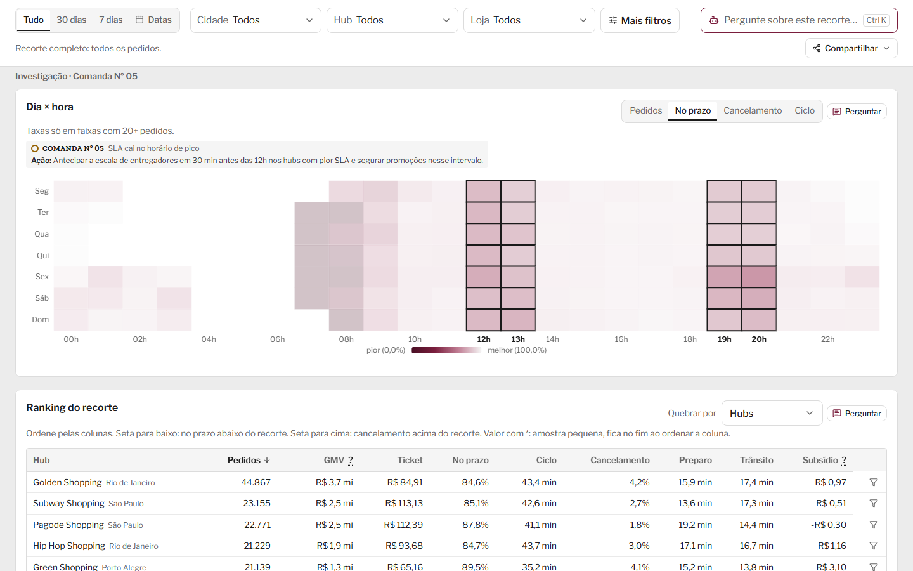
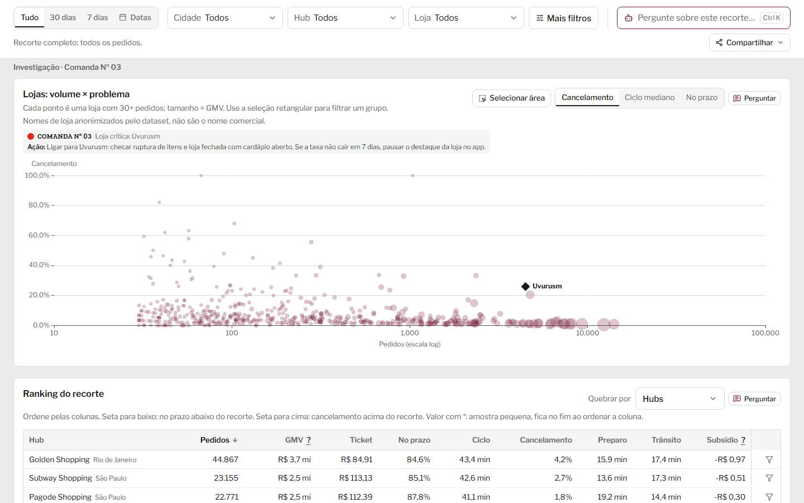
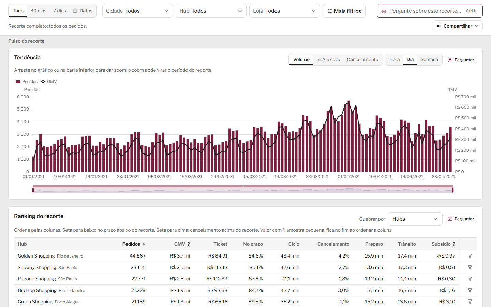
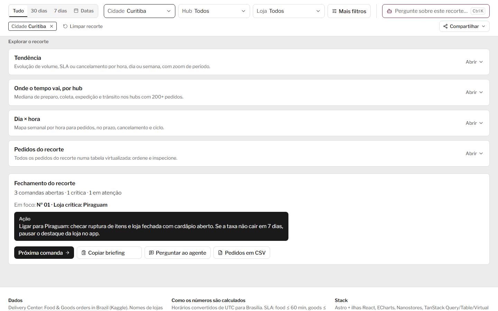
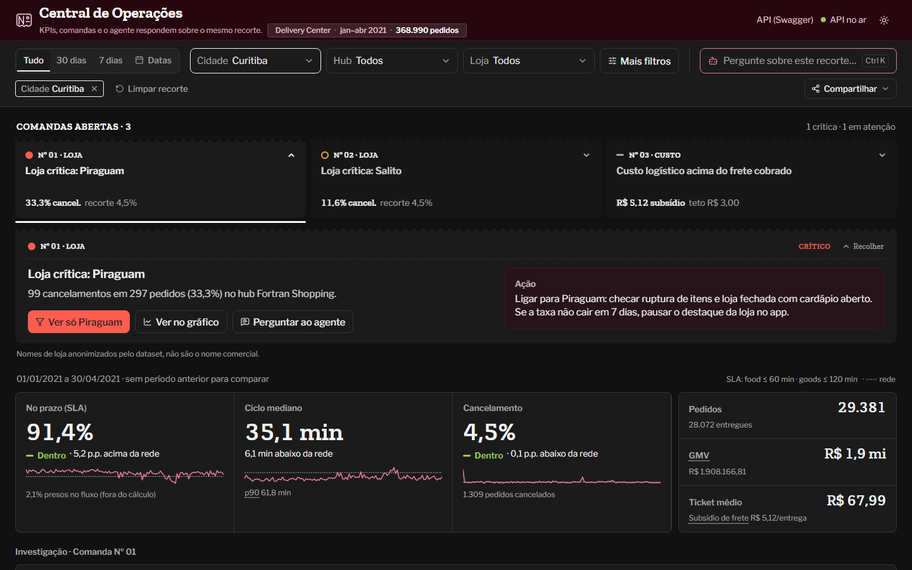

## Arquitetura

```
frontend/ (Vercel)                         backend/ (Render)
Astro: casca estática, zero JS     HTTP    FastAPI + Pydantic
 └─ ilhas React (client:load/visible) ───▶  ├─ repository.py  DuckDB em memória ← data/orders.parquet
    Nanostores: recorte ↔ URL               ├─ alerts.py      regras → alerta + ação + evidência + drill-down
    TanStack Query: cache, cancelamento     └─ agent/         LLM com tools → contexto → regras locais
    ECharts · TanStack Table/Virtual
    Tipos TS gerados do OpenAPI
```

Decisões que vale conhecer:

- **DuckDB sobre Parquet, sem banco.** O dataset tem 9,8 MB em Parquet; o DuckDB carrega tudo em memória e calcula os KPIs de 369 mil linhas em menos de 100 ms, e um cache LRU devolve recortes repetidos em menos de 1 ms. O SQL recebe valores só por parâmetros, e colunas e ordenações vêm de listas fixas.
- **Um contrato de filtro.** `Filters` (Pydantic) é a query string da API e da URL do navegador. Os tipos TypeScript são gerados do OpenAPI: se um schema muda, o `astro check` quebra no build.
- **Ilhas que se falam sem Provider global.** O filtro grava num átomo Nanostores; KPIs, gráficos, tabelas e agente são ilhas separadas que escutam o mesmo átomo e compartilham um `QueryClient`. A comanda aberta publica sua evidência num segundo átomo: ele decide qual gráfico sobe para a investigação (os painéis são movidos no DOM, não reordenados por CSS), o que esse gráfico destaca e o que o fechamento mostra em foco.
- **Sem salto de layout.** Moldura, título e dica fixa de cada painel saem no HTML do Astro; a ilha só preenche o corpo, e o skeleton reserva a altura final. Acima da dobra hidrata com `client:load`; gráficos, tabelas e fechamento com `client:visible`, e os painéis recolhidos só hidratam quando abertos; a conversa do agente, a folha de filtros e o diálogo de exportação entram com `React.lazy`.
- **Agente com limites.** O LLM fecha a resposta num bloco estruturado que o backend valida: atalho para hub ou loja que não existe no recorte é descartado. Até 3 rodadas de ferramentas, orçamento de 20 s por pergunta (prazo de relógio, não só de leitura: o OpenRouter manda keep-alive), disjuntor de cota que desliga o LLM até o reset depois de um 429 (o plano gratuito sem créditos dá 50 chamadas por dia), histórico curto, corpo de até 64 KB (contado no stream, não só no `Content-Length`), 8 perguntas por minuto por IP e um teto global por minuto. Se o LLM falha, demora ou a cota acaba, a resposta vem das regras locais em vez de um erro.

## Limpeza dos dados

O ETL (`backend/scripts/build_parquet.py`) junta os 7 CSVs num parquet desnormalizado. Estas decisões mudam números; as principais (fuso, SLA, pedidos presos, outliers de valor e régua dos KPIs) também aparecem no rodapé do app, e um teste falha se rodapé, README e código divergirem:

- **Fuso:** os horários do dataset estão em UTC (picos às 15h e 22h). Convertidos para Brasília, os picos ficam no almoço e no jantar.
- **SLA por segmento:** food ≤ 60 min, goods ≤ 120 min. Goods tem um ciclo bem mais longo e não dá para medir pela mesma régua.
- **Pedidos presos:** ciclo > 4h (4,9% das entregas, concentradas em goods) fica fora das medianas e do SLA e gera um alerta de dados próprio.
- **Outliers:** pedidos acima de R$ 5 mil (63, como um de R$ 100.000,11) ficam fora do GMV e do ticket médio. Distâncias acima de 50 km e métricas negativas viram nulo.
- **Várias entregas/pagamentos por pedido:** vale a última entrega concluída e o meio de pagamento de maior valor.
- **Amostra pequena:** SLA e ciclo com menos de 100 entregas medidas não geram alerta forte, veredito nem comparação (com a rede ou com o período anterior). Cancelamento usa o total de pedidos com o mesmo piso, salvo taxa extrema (nenhuma entrega ou 90% ou mais). Pedidos, GMV e ticket só comparam período com 100 pedidos ou mais em cada lado.
- **Referência dos KPIs:** recorte menor que a rede compara com a rede no mesmo período. Sem filtro além do período, a referência é a faixa entre os hubs. O veredito (dentro, atenção, crítico) usa a régua das comandas: atenção abaixo de 85% no prazo (crítico abaixo de 80%) e cancelamento a partir de 6% (crítico a partir de 9%). Não há meta de SLA em percentual: 60 e 120 min são o prazo de cada pedido, não um alvo da mediana de ciclo.

## Rodar localmente

```bash
# backend: Python 3.11+
cd backend
python -m venv .venv && .venv\Scripts\activate      # Linux/macOS: source .venv/bin/activate
pip install -r requirements-dev.txt
uvicorn app.main:app --reload                       # http://localhost:8000/docs
pytest                                              # parquet sintético (não precisa do Kaggle)
python -m evals.run --engine local --out placar.md  # placar do agente (45 perguntas); --engine auto inclui o LLM

# frontend: Node 22+ (o Astro 7 exige >= 22.23.4)
cd frontend
npm install
npm run dev                                         # http://localhost:4321
npm run build                                       # astro check + build estático
```

O parquet processado já vem no repositório. Para refazer o ETL, coloque os CSVs do Kaggle em `backend/data/raw/` e rode `python scripts/build_parquet.py`.

Mudou um schema Pydantic? Regere os tipos do frontend: `python scripts/export_openapi.py && (cd ../frontend && npm run gen:api)`.

Agente com LLM (opcional): copie `backend/.env.example` para `backend/.env` e preencha `OPENROUTER_API_KEY`. O backend também lê o `.env` da raiz (o de `backend/` vence). Variáveis opcionais:

| Variável | Padrão | Para quê |
|---|---|---|
| `OPENROUTER_API_KEY` | vazio | Liga o agente com LLM. Vazio: só regras locais |
| `OPENROUTER_MODEL` | `baidu/ernie-5.5-flash-preview:free` | Modelo usado pelo agente (escolhido num confronto de 5 modelos gratuitos com o placar) |
| `OPENROUTER_FALLBACK_MODELS` | vazio | Modelos de reserva, por vírgula, que o OpenRouter tenta se o principal falhar. Vazio: congestionamento ganha uma nova tentativa no mesmo modelo e, se falhar, vale a leitura por regras |
| `LLM_TIMEOUT_S` | `18` | Tempo máximo de cada chamada ao LLM |
| `LLM_MAX_TOKENS` | `2000` | Limite de tokens gerados por resposta |
| `LLM_REASONING_EFFORT` | `low` | Esforço de raciocínio enviado via OpenRouter (`low`, `medium`, `high` ou vazio) |
| `CHAT_BUDGET_S` | `20` | Tempo total por pergunta antes de cair nas regras locais |
| `CHAT_RATE_LIMIT_PER_MINUTE` | `8` | Perguntas ao LLM por minuto por IP |
| `CHAT_GLOBAL_RATE_LIMIT_PER_MINUTE` | `60` | Teto de chamadas ao LLM por minuto, somando todos os IPs. `0` desliga |
| `CHAT_RATE_LIMIT_ENABLED` | `true` | Liga as cotas acima |
| `CLIENT_IP_HEADER` | vazio | Header de IP confiável, se o proxy mandar um (`true-client-ip` ou `cf-connecting-ip`). Vazio: último hop de `X-Forwarded-For`. O Render não documenta `True-Client-IP` como header próprio |
| `CSV_EXPORT_MAX_ROWS` | `50000` | Teto de linhas do CSV. Acima disso a API responde 413 e pede um recorte menor |
| `CSV_EXPORT_PER_MINUTE` | `30` | Exportações CSV por minuto por IP. `0` desliga |
| `AUTOMATION_TOKEN` | vazio | Se preenchido, `/api/briefing` e `/api/alerts/routing` exigem `X-Automation-Token`. Vazio: abertos, como o workflow n8n versionado |
| `CORS_ORIGINS` | `http://localhost:4321,http://127.0.0.1:4321` | Origens liberadas, separadas por vírgula. Em produção, a URL da Vercel |
| `CORS_ORIGIN_REGEX` | vazio | Regex de origem extra, por exemplo para os previews da Vercel |
| `SLA_FOOD_MIN` / `SLA_GOOD_MIN` | `60` / `120` | Prazo de ciclo por segmento, em minutos. Mudar o padrão exige atualizar rodapé, README e testes |
| `DATA_PATH` | `backend/data/orders.parquet` | Parquet carregado na subida |

## API

A query string é o recorte do painel: `start`, `end`, `city`, `hub`, `store`, `segment` (`food` ou `good`), `channel_type`, `modal` e `status`. Data inválida ou `end` anterior a `start` responde 422. O contrato inteiro está em `/docs`.

| Grupo | Rotas |
|---|---|
| Infra e recorte | `GET /api/health`, `GET /api/meta` (opções dos filtros e período dos dados) |
| Análise | `GET /api/kpis`, `/api/timeseries`, `/api/heatmap`, `/api/breakdown`, `/api/alerts` |
| Pedidos | `GET /api/orders` (página com ordenação), `GET /api/orders.csv` |
| Agente | `POST /api/agent/chat` (`engine: "local"` força as regras, sem gastar cota do LLM) |
| Automação | `GET /api/briefing`, `GET /api/alerts/routing` |

Resposta 200 dos GETs analíticos leva `Cache-Control: public, max-age=600`; `/api/health` sai sem cache e o CSV com `no-store`. Respostas grandes saem com gzip.

Os dois GETs de automação alimentam agendador e mensagem sem chamar o agente com LLM. Com `AUTOMATION_TOKEN` no ambiente, os dois exigem o header `X-Automation-Token` (comparação em tempo constante). Sem a variável, seguem abertos: o JSON do n8n não envia esse header.

`GET /api/orders.csv` exporta o recorte até `CSV_EXPORT_MAX_ROWS` (50 mil). Passou disso, responde 413 e pede para afinar o filtro. Acima do limite por minuto por IP, responde 429 com `Retry-After`.

| | |
|---|---|
| `GET /api/briefing` | `{markdown, start, end, alert_count}`. `markdown` é o briefing local do recorte. `start` e `end` são as datas pedidas; sem elas, o primeiro e o último dia com pedido no recorte, ou `null` se não houver pedido. `alert_count` é o tamanho da fila de alertas. |
| `GET /api/alerts/routing` | Lista `{alert_id, severity, recipient, message}`. `recipient` sai do drill-down, da evidência ou do id do alerta: `Loja {nome} ({id})` ou `Líder do hub {nome} ({id})` (no plural quando o alerta cobre vários), com o nome vindo dos dados. Sem loja nem hub, fica `Time de operações da praça`. `message` junta o problema (números já em pt-BR) e a ação. Template fixo, sem LLM. |

## Deploy

1. **Backend (Render):** *New → Blueprint* apontando para este repo (usa `render.yaml`). Preencha `CORS_ORIGINS` com a URL da Vercel (ou `CORS_ORIGIN_REGEX` para aceitar os previews) e, se quiser, `OPENROUTER_API_KEY`. O plano grátis dorme depois de 15 min sem acesso; o app mostra "Acordando o servidor" enquanto isso.
2. **Frontend (Vercel):** importe o repo com *Root Directory* = `frontend` e defina `PUBLIC_API_URL` com a URL do Render.

## Stack

Astro 7 · React 19 · TypeScript · Tailwind CSS 4 · Lucide · Apache ECharts 6 · Nanostores · TanStack Query / Table / Virtual · Python · FastAPI · Pydantic · DuckDB · Parquet · OpenRouter (API compatível com OpenAI).

Dados: Delivery Center, Kaggle. Os nomes de lojas vêm anonimizados no próprio dataset. Projeto independente, sem relação com o iFood.
