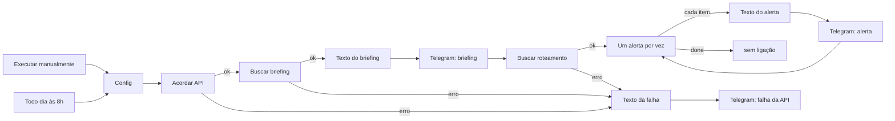

# Como o briefing diário funciona

O arquivo `briefing-diario.json` é o workflow `briefing-diario` (id `briefingDiario01`). Ele sai do arquivo com `"active": false`: o horário não dispara até alguém ativar o workflow no n8n. O fuso está em `settings.timezone`, `America/Sao_Paulo`. Execuções manuais ficam no histórico (`saveManualExecutions`).

Os dois gatilhos chegam no mesmo nó Config. Dali o fluxo pede `GET /api/health`, depois `GET /api/briefing` e `GET /api/alerts/routing` para um único dia do dataset, formata o texto e manda no Telegram. A saída de erro dos três HTTP Request vai para um aviso fixo. A mensagem de uma execução real está em [exemplo-briefing.md](exemplo-briefing.md). O passo a passo para importar e ligar o bot está em [README.md](README.md).



Cada HTTP Request tem duas saídas. A primeira continua o caminho. A segunda, a de erro, vai para Texto da falha. O n8n só usa a saída de erro depois das 3 tentativas. Numa execução, o primeiro HTTP que esgota as tentativas desvia para o aviso e os HTTP seguintes não rodam.

## Nó a nó

### Executar manualmente

Gatilho manual (`manualTrigger`). Roda o fluxo no momento em que você aperta Execute no editor, ou quando a CLI chama `n8n execute`.

Serve para testar sem esperar as 8h. Com o workflow inativo, este é o gatilho que ainda funciona.

Se ele não dispara, nenhum nó seguinte roda e o Telegram não recebe nada.

### Todo dia às 8h

Schedule Trigger, uma vez por dia, hora 8, minuto 0. O nó não tem fuso próprio: usa `America/Sao_Paulo` das configurações do workflow. 8h é horário de São Paulo, mesmo com o relógio da máquina em UTC.

É o agendamento do briefing. Os dois gatilhos fazem o mesmo trabalho a partir do Config; cada execução começa em um deles.

O schedule só dispara com o workflow ativo e com o processo do n8n no ar nesse minuto. Processo desligado às 8h significa que aquele dia não roda. O arquivo traz `"active": false`, então importar não liga o horário.

### Config

Edit Fields (nó Set). Grava três campos num único item:

| Campo | No arquivo | Papel |
|---|---|---|
| `api_base` | `http://127.0.0.1:8000` | Origem da API. Texto fixo, sem expressão. |
| `data_ref` | expressão Luxon | O dia do dataset que representa "hoje". |
| `chat_id` | `SEU_CHAT_ID` | Destino no Telegram. Texto fixo, para trocar pelo id do chat. |

Os nós seguintes leem esses campos com `$('Config').first().json...`. A URL, o dia e o chat ficam num lugar só.

`api_base` usa `127.0.0.1` porque, no Windows, `localhost` resolveu para o IPv6 `::1` e o uvicorn deste projeto escuta só IPv4. Depois do deploy, o valor passa a ser `https://central-operacoes-api.onrender.com`.

Se a expressão de `data_ref` quebrar, a execução para aqui. Não há chamada HTTP e não há mensagem no Telegram. Um `api_base` errado só aparece no nó Acordar API, que aí manda o aviso de falha, desde que o `chat_id` seja um chat de verdade. `SEU_CHAT_ID` faz o Telegram recusar o envio: o aviso de falha usa o mesmo chat, então ele também não chega. O erro fica no histórico do n8n.

A expressão de `data_ref` está decomposta na seção Expressões.

### Acordar API

HTTP Request, `GET {api_base}/api/health`. A resposta é `{"status": "ok", "orders": N}`. O fluxo não lê o corpo. A chamada existe pelo efeito de acordar o processo.

O plano grátis do Render dorme depois de 15 min sem acesso. A primeira requisição sobe a API e o DuckDB carrega o parquet, até cerca de 40 s. Este nó absorve essa espera antes do briefing. Retry On Fail: 3 tentativas, 5 s entre elas, timeout de 60 s por tentativa. On Error: continue (using error output). A saída de sucesso vai para Buscar briefing. A de erro vai para Texto da falha.

O motor do n8n limita `waitBetweenTries` a 5000 ms. Um intervalo de 20 s entre tentativas não cabe. O timeout de 60 s cobre a subida do Render: uma tentativa pode esperar o processo acordar.

Recusa de conexão falha na hora, sem esperar os 60 s. No teste com a porta sem serviço foram 3 tentativas em cerca de 10 s (duas esperas de 5 s) e a mensagem de falha chegou no Telegram. Porta fechada e Render acordando são casos diferentes: na subida, cada tentativa pode ocupar até 60 s.

Resposta que não seja sucesso HTTP (o nó não está com Never Error) também cai na saída de erro, depois das 3 tentativas.

### Buscar briefing

HTTP Request, `GET {api_base}/api/briefing?start={data_ref}&end={data_ref}`. Mesmas 3 tentativas, 5 s, timeout de 60 s e saída de erro para Texto da falha.

Pede o texto que o operador recebe: números do dia e as ações. `start` e `end` são a mesma data, e o filtro do backend trata as duas como inclusivas. A resposta é `{markdown, start, end, alert_count}`. O nó seguinte usa só `markdown`. Os alertas com destinatário saem na chamada de roteamento.

`markdown` vem de `briefing()` em `backend/app/agent/local.py`: números do recorte e, no máximo, quatro alertas com a ação. O roteamento, mais adiante, encaminha todos os alertas do dia. No dia 22/02/2021 havia dois, então as duas mensagens bateram. Com cinco alertas, o texto do operador traz quatro e o loop manda cinco.

Sucesso segue para Texto do briefing. Erro segue para Texto da falha, e nesse caso o operador ainda não recebeu briefing. Data inválida ou `end` anterior a `start` responde 422, como o resto da API. Aqui as duas datas são iguais, então esse 422 não nasce desta expressão.

### Texto do briefing

Edit Fields. Monta o campo `text`: o prefixo `📋 Briefing de dd/LL/yyyy` (a data é `data_ref`, no formato brasileiro) e, depois de uma linha em branco, o `markdown` da API com `**` trocado por `*`.

A API escreve negrito no Markdown comum (`**assim**`). O parse mode Markdown legado do Telegram usa um asterisco só (`*assim*`). Sem o `replaceAll`, o Telegram recebe os asteriscos dobrados.

Não tem retry nem saída de erro. Se `markdown` não vier, `replaceAll` quebra e a execução para. O aviso "API indisponível" não sai, porque ele só está ligado nos HTTP Request. O operador fica sem mensagem, e o erro aparece na execução do n8n.

### Telegram: briefing

Nó Telegram, `sendMessage`. Chat = `chat_id` do Config. Texto = `$json.text`. Parse mode Markdown. `appendAttribution` desligado, para não acrescentar a frase automática do n8n no fim. Retry On Fail: 3 tentativas, 5 s entre elas.

A credencial no JSON tem id vazio e nome "Telegram account". O token não está no arquivo. Na instância, o nó usa a credencial Telegram API que a pessoa criou.

Sucesso segue para Buscar roteamento. Se o envio falha depois das 3 tentativas (chat errado, token revogado, Markdown rejeitado por `*` ou `_` sem fechar), a execução para. O roteamento não roda e o aviso de API também não, porque essa saída de erro não existe neste nó. Asterisco sem par no texto é um erro de conteúdo: repetir a tentativa não conserta.

### Buscar roteamento

HTTP Request, `GET {api_base}/api/alerts/routing` com o mesmo `start` e `end`. Mesmas tentativas, o mesmo timeout e a mesma saída de erro.

A resposta é um array. Cada elemento vira um item do n8n, com `alert_id`, `severity`, `recipient` e `message`. O destinatário e o texto nascem em `backend/app/routing.py`, por template, a partir do alerta que o servidor já calculou. Esta chamada existe para uma mensagem por alerta, com o papel de quem age. O briefing do operador não traz esse destinatário.

Sucesso segue para Um alerta por vez. Erro segue para Texto da falha. Neste ponto o briefing do operador já foi enviado. Em seguida chega também "Briefing não gerado: API indisponível". O texto de falha é fixo: não diz qual chamada quebrou.

Lista vazia é sucesso HTTP com zero itens. O loop não manda alerta, e o aviso de falha não entra.

### Um alerta por vez

Loop Over Items (`splitInBatches`, versão 3), lote de 1. A saída `done` (a primeira do nó, índice 0) não tem ligação. A saída do lote vai para Texto do alerta. Telegram: alerta volta para este nó, que pega o próximo item.

Cada volta manda uma mensagem e só então o loop pede o alerta seguinte.

Com zero itens, `done` dispara na hora e a execução termina. O briefing, se chegou nessa etapa, já está no chat. Quando o último alerta volta ao loop e não há próximo item, `done` dispara de novo e nada mais acontece. Não há mensagem de "enviei N alertas".

### Texto do alerta

Edit Fields. Monta `text` para o item atual:

- `high` vira 🔴
- `medium` vira 🟠
- qualquer outro valor, na prática `low`, vira ⚪

Depois, uma linha `*Para: {recipient}*` e, em seguida, `message`. O negrito é o do Telegram (`*...*`), então este texto não passa por `replaceAll`.

`recipient` é um papel montado no servidor, com o id da loja ou do hub: `Loja {id}`, `Lojas {ids}`, `Líder do hub {id}`, `Líder dos hubs {ids}`, ou `Time de operações da praça` quando o alerta não tem loja nem hub. `message` junta título, detalhe e ação.

O `chat_id` não muda aqui. "Para:" é texto dentro da mensagem. No portfólio, operador e responsáveis caem no mesmo chat.

Sem saída de erro. Se a expressão quebrar, o loop para naquele item. Alertas já enviados permanecem. Os seguintes não saem. O aviso de API não é enviado.

### Telegram: alerta

Igual ao Telegram do briefing: mesma credencial, Markdown, sem atribuição do n8n, 3 tentativas, 5 s, chat do Config, texto do nó anterior. A diferença é o destino no fluxo: a saída volta para Um alerta por vez.

Se um envio falha depois das tentativas, a execução para nesse alerta. Os anteriores ficam no chat. Os posteriores não são enviados. Não há aviso de falha da API.

### Texto da falha

Edit Fields com o texto fixo `Briefing não gerado: API indisponível`. Não é expressão. Não inclui status HTTP, URL nem o nome do nó que falhou.

Existe para o chat receber alguma coisa quando a API não responde, em vez de a execução só ficar vermelha no n8n. Recebe a saída de erro de Acordar API, Buscar briefing e Buscar roteamento.

Um Set com texto fixo não falha na prática. Se falhasse, o Telegram de falha não rodaria.

### Telegram: falha da API

Manda o texto do nó anterior para o mesmo `chat_id`, com a mesma credencial, o mesmo Markdown, sem atribuição e com as mesmas 3 tentativas.

Foi o nó que entregou a mensagem no teste da porta sem serviço, depois das 3 tentativas do Acordar API.

Se este envio falha (chat inexistente, token ruim, Telegram fora), as 3 tentativas se esgotam e a execução termina em erro. Não há outro canal de aviso. O aviso de falha depende do mesmo chat e da mesma credencial do envio normal.

## Expressões

No JSON, campo de expressão começa com `=`. `api_base`, `chat_id` e o texto de falha não têm `=`: são texto fixo. Quebra de linha dentro de uma expressão aparece como `\\n` no arquivo porque isso é uma string JSON. No editor do n8n é `\n`, uma quebra de linha.

### `data_ref`, passo a passo

A expressão no nó Config:

```text
DateTime.fromISO('2021-01-02').plus({
  days: Math.round(
    DateTime.fromISO($now.setZone('America/Sao_Paulo').toISODate())
      .diff(DateTime.fromISO('2021-01-02'), 'days').days
  ) % 116
}).toISODate()
```

O dataset cobre janeiro a abril de 2021. A expressão trata a janela como 116 dias, de 2021-01-02 a 2021-04-27 inclusive (02/01 + 115 dias = 27/04; a contagem inclusiva é 116). "Hoje" em 2026 está fora dessa janela. O resto da divisão por 116 escolhe um dia dentro dela, e a sequência recomeça no dia seguinte ao 27/04.

`$now` é o instante em que o nó Config roda, não a data em que o arquivo foi salvo.

No dia 11/11/2026, em São Paulo, o resultado é `2021-02-22`. As mensagens de [exemplo-briefing.md](exemplo-briefing.md) são desse dia.

1. `$now.setZone('America/Sao_Paulo')` põe o instante no fuso de São Paulo. `.toISODate()` devolve só a data de calendário: `2026-11-11`. O fuso entra de novo aqui, além do `settings.timezone`, para o dia não seguir o relógio UTC da máquina. Às 02:00 UTC do dia 11 ainda é 23:00 do dia 10 em São Paulo. Sem `setZone`, a data poderia ser o dia errado.

2. `DateTime.fromISO('2026-11-11')` lê essa data. `.diff(DateTime.fromISO('2021-01-02'), 'days').days` é a distância até 02/01/2021: 2139 dias.

3. `Math.round(2139)` continua 2139. `.days` conta blocos de 24 horas. Num fuso que adianta ou atrasa o relógio no horário de verão, o número pode voltar como `2138.958` ou `2139.042`. O `Math.round` devolve a contagem em dias de calendário. Em `America/Sao_Paulo` não há horário de verão desde 2019, então neste intervalo o valor já é inteiro. O arredondamento fica para o caso do relógio ter mudado uma hora.

4. `2139 % 116` é o resto da divisão por 116. `116 × 18 = 2088` e `2139 - 2088 = 51`. O resto 0 seria 2021-01-02. O resto 115 seria 2021-04-27. 116 dividido por 116 deixa resto 0, e a janela recomeça em 2021-01-02.

5. `DateTime.fromISO('2021-01-02').plus({ days: 51 }).toISODate()` soma 51 dias a 02/01/2021. 02/01 é o dia 2 do ano; 22/02 é o dia 53 (janeiro tem 31 dias, e 2021 não é bissexto). `53 - 2 = 51`. A data é 2021-02-22.

Conferência:

```text
hoje em São Paulo     2026-11-11
distância até 02/01   2139 dias
2139 = 116 × 18 + 51  resto 51
02/01/2021 + 51 dias  2021-02-22
```

### `$('Config').first()` em vez de `.item`

`$('Config')` é a saída do nó Config. `.json.api_base`, `.json.data_ref` e `.json.chat_id` são os três campos.

`.item` segue o pareamento: qual item daquele nó o n8n acha que corresponde ao item atual. Config tem um item só, mas o pareamento se perde no caminho. O HTTP Request substitui o item pela resposta, e o loop trabalha um alerta por vez. `.first()` pega o primeiro item do Config, que é o único, sem depender desse pareamento. Por isso a URL, o dia e o chat continuam certos dentro do loop.

Essa forma aparece na URL dos três HTTP Request, nos query params `start` e `end`, no texto do briefing e no `chatId` dos três nós Telegram.

### `$json`

É o item que entrou no nó.

- Em Texto do briefing, é a resposta de `/api/briefing`. `$json.markdown` é o texto com `**`.
- Em Texto do alerta, é um elemento do array de `/api/alerts/routing`: `severity`, `recipient`, `message`.
- Nos nós Telegram, é a saída do Set anterior. `$json.text` é o campo `text` que aquele Set acabou de montar.

### Texto do briefing

```text
'📋 Briefing de '
  + DateTime.fromISO($('Config').first().json.data_ref).toFormat('dd/LL/yyyy')
  + '\n\n'
  + $json.markdown.replaceAll('**', '*')
```

`DateTime.fromISO` lê `2021-02-22`. `toFormat('dd/LL/yyyy')` formata dia, mês e ano com dois, dois e quatro dígitos: `22/02/2021`. No Luxon, `LL` é o mês numérico com zero à esquerda. O prefixo usa `data_ref`, não o dia em que o fluxo rodou. Em 11/11/2026 a primeira linha é `📋 Briefing de 22/02/2021`.

`replaceAll('**', '*')` troca todas as ocorrências, não só a primeira.

### Texto do alerta

```text
($json.severity === 'high' ? '🔴' : $json.severity === 'medium' ? '🟠' : '⚪')
  + ' *Para: ' + $json.recipient + '*\n\n'
  + $json.message
```

O ternário é o `if` da expressão. Severidade `high`, emoji vermelho. `medium`, laranja. No terceiro ramo, branco. A API só emite `high`, `medium` e `low`, então o terceiro ramo é o alerta baixo.

Os asteriscos em volta de `Para:` já são o negrito do Telegram. `\n\n` abre uma linha em branco antes da mensagem, como no exemplo.

### O que os nós Telegram enviam

`chatId` é `$('Config').first().json.chat_id` nos três. `text` é `$json.text`. Nenhum dos três escreve a frase do briefing ou do alerta na mão: eles mandam o campo que o Set anterior preparou.

## Como a execução foi feita

Import e execução pela CLI, a partir da pasta do repositório:

```text
n8n import:workflow --input=n8n/briefing-diario.json
n8n execute --id=briefingDiario01
```

Com o servidor do n8n já aberto, a CLI precisa de `N8N_RUNNERS_BROKER_PORT=5690`. Sem isso ela tenta subir o task broker na porta 5679, que o servidor já ocupa.

O teste de falha apontou `api_base` para uma porta sem serviço. Acordar API fez 3 tentativas em cerca de 10 s e o Telegram entregou "Briefing não gerado: API indisponível".

## Perguntas de entrevista

### Por que o roteamento não usa LLM?

`GET /api/alerts/routing` chama `route_alerts` em `backend/app/routing.py`. O destinatário sai dos ids que o alerta já traz: filtros do drill-down, listas da evidência, ou o sufixo `store-N` / `hub-N` no id. Loja vira `Loja N` (ou `Lojas ...` se houver mais de uma). Sem loja, hub vira `Líder do hub N`. Sem loja e sem hub, fica `Time de operações da praça`. A mensagem é o template `"{título}. {detalhe} Ação: {ação}"`. Os números já chegam em pt-BR, formatados no servidor.

O mesmo alerta produz o mesmo texto. Não entra API key. Um modelo no meio pode trocar um percentual, citar outra loja ou cortar a ação. O agente do painel até usa LLM, e só como melhoria: sem chave ele cai nas regras locais. O caminho das 8h não passa pelo agente. O briefing também é template, `briefing()` em `backend/app/agent/local.py`. No n8n, a formatação é o emoji, o prefixo e a troca de `**` por `*`.

### Por que o recorte fica no servidor?

O workflow manda só `start` e `end`, os dois iguais a `data_ref`. Quem aplica isso nos pedidos é `Filters` em `backend/app/filters.py`: o `WHERE` usa parâmetros, não texto colado na SQL. SLA por segmento, pedido preso e corte de GMV ficam no backend. O n8n não escolhe cidade, hub, loja nem coluna.

A regra do projeto é essa para o painel e para o agente. Quem pergunta pode escolher a consulta. O servidor decide sobre quais linhas ela roda. Se a régua do SLA mudar, a mensagem das 8h muda sem editar o JSON do n8n.

O dia mapeado é o dataset inteiro naquela data. O fluxo não reduz para uma cidade. Reduzir seria mais um query param, ainda avaliado no servidor.

### Se rodar duas vezes, manda de novo?

Manda. Não há registro de "já enviei este dia", nem chave de idempotência, nem checagem no Telegram antes do `sendMessage`. Duas execuções no mesmo dia de São Paulo usam o mesmo `data_ref` e o mesmo parquet, então o texto se repete. A segunda execução é um reenvio, não uma correção da primeira.

O schedule dispara uma vez às 8h. O segundo envio aparece quando alguém aperta Execute no mesmo dia, quando a CLI roda de novo, ou quando o manual e o horário caem os dois. Mensagens que já tinham saído continuam no chat.

### O que muda para produção?

Hoje existe um `chat_id`. A linha `*Para: Líder do hub 31*` diz quem deveria agir, e a mensagem cai no mesmo chat do operador. No portfólio isso simula o encaminhamento. Em produção, cada papel precisa do próprio chat: um mapa de destinatário (ou de hub e loja) para o id da conversa, e o nó Telegram: alerta usa esse id. O briefing do operador pode seguir num chat separado, no `chat_id` do Config.

A credencial não viaja no JSON. O id vem vazio e o nome é "Telegram account". Em outra instância, a pessoa cria a credencial Telegram API dela e seleciona nos três nós. O token fica no n8n, não no git, no nó ou no chat. Se vazar, `/revoke` no BotFather e a credencial é atualizada. O token antigo deixa de valer.

`api_base` deixa `http://127.0.0.1:8000` e passa a ser `https://central-operacoes-api.onrender.com`. Instância na nuvem não alcança o `127.0.0.1` da sua máquina.

Aqui o n8n é a Community Edition, local e gratuita. O arquivo `n8n/briefing-diario.json` importa em qualquer instância. Self-hosted: o processo tem de estar no ar às 8h, o workflow ativo, o fuso do workflow em `America/Sao_Paulo`. n8n Cloud: o horário roda sem o seu computador ligado, a API tem de ser a URL pública, e a credencial é criada naquela instância, porque o export não a carrega.

### Por que acordar o Render antes?

O plano grátis dorme sem acesso. A primeira visita leva até cerca de 40 s, o mesmo aviso que o topo do painel mostra. `/api/health` é a chamada que sobe o processo. Ela devolve `status` e a contagem de pedidos. Não monta briefing nem alerta. O fluxo ignora o corpo: o valor da chamada é a API estar de pé antes de `/api/briefing` e `/api/alerts/routing`.

Cada HTTP tem timeout de 60 s, acima desses cerca de 40 s, e 3 tentativas. Entre tentativas o motor só espera 5 s. Se a primeira requisição cair enquanto a instância sobe, quem repete é o health. O briefing encontra o processo acordado. Se o health esgotar as tentativas, o chat recebe o aviso e o fluxo não monta o briefing.

Isso é separado do teste da porta fechada. Lá a conexão é recusada na hora, as 3 tentativas levam cerca de 10 s e a mensagem de falha sai. O timeout de 60 s é para a espera do Render, não para esse teste.
